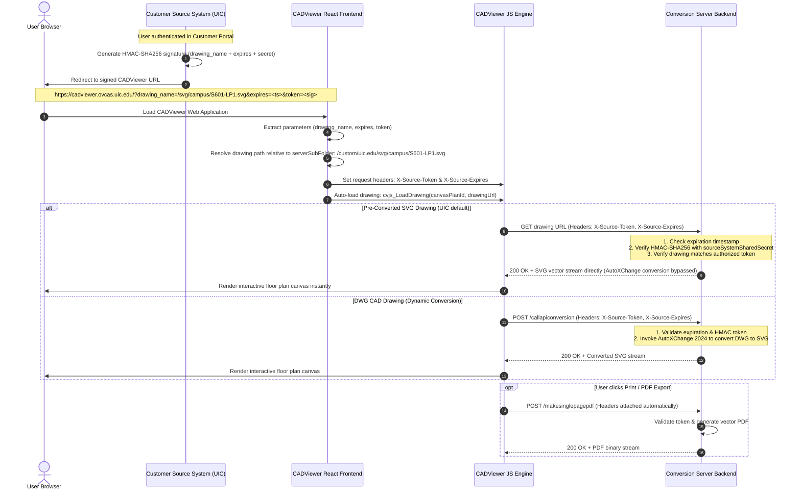

# CADViewer Source Token Security: Full Architecture & Integration Guide
## (Frontend & Backend Integration for UIC and Multi-Tenant Deployments)

---

## 1. Executive Summary

This document describes the end-to-end security architecture and implementation for **Source Token Security** in CADViewer. 

This feature allows external authorization systems (such as the University of Illinois Chicago — UIC, or any enterprise customer) to generate time-limited, cryptographically signed URLs for direct drawing viewing. The backend conversion server verifies the HMAC-SHA256 signature and expiration timestamp before allowing any CAD drawing conversion, SVG content streaming, or PDF generation. The shared secret remains exclusively on the backend and authorization system, never exposed to client bundles or browser code.

---

## 2. End-to-End Architecture & Sequence Flow



---

## 3. URL Parameter Specification (Frontend Deep-Linking)

### URL Structure
For pre-converted SVG drawings (standard UIC format):
```
https://cadviewer.ovcas.uic.edu/?drawing_name=/svg/campus/S601-LP1.svg&expires=<unix-timestamp>&token=<signature>
```
For native DWG drawings:
```
https://cadviewer.ovcas.uic.edu/?drawing_name=/dwg/S949-1.dwg&expires=<unix-timestamp>&token=<signature>
```
For custom tenant substructures:
```
https://cadviewer.ovcas.uic.edu/?drawing_name=/facilities/building_A/floor_02.svg&expires=<unix-timestamp>&token=<signature>
```

### Parameter Reference
| Parameter | Type | Required | Description |
|---|---|---|---|
| `drawing_name` | String | Yes* | The drawing path and filename (`path + file.ext`) **relative to `serverSubFolder`**. Supports pre-converted SVGs (e.g. `/svg/campus/S601-LP1.svg`, `/svg/xxxx.svg`), DWGs (e.g. `/dwg/S949-1.dwg`), or custom customer folder paths. |
| `drawing` | String | Yes* | Alternative alias for `drawing_name` (e.g. `?drawing=/svg/campus/S601-LP1.svg`). |
| `expires` | Integer (String) | Yes (when security enabled) | Unix epoch timestamp in seconds (e.g. `1794854048`) or milliseconds indicating when link access expires. |
| `token` | String | Yes (when security enabled) | The HMAC-SHA256 signature produced by the source system using `sourceSystemSharedSecret`. |

*\* Either `drawing_name` or `drawing` is required.*

---

## 4. Content Location Architecture: `folderLocation` + `serverSubFolder` + `path` + `file.ext`

### 4.1. The Content Location Formula

The location of drawing content in CADViewer is defined by a clear, four-part composition:

$$\mathbf{Final\ Server\ File\ Location} = \mathbf{folderLocation} + \mathbf{serverSubFolder} + \mathbf{path} + \mathbf{file.ext}$$

```
+------------------------------------------------------------------------------------------------------------------+
| Final Content Location = folderLocation + serverSubFolder + path + file.ext                                      |
|                                                                                                                  |
|  1. folderLocation   (CADViewer_config.json):      /nodejs/cadviewer-conversion-server-nextgen/content          |
|  2. serverSubFolder  (tenant subfolder):          /custom/your-organization.com/                                 |
|  3. path + file.ext  (from URL ?drawing_name=):   /svg/campus/S601-LP1.svg                                       |
|  --------------------------------------------------------------------------------------------------------------- |
|  Final Server Path:                               /nodejs/cadviewer-conversion-server-nextgen/content/custom/    |
|                                                   your-organization.com/svg/campus/S601-LP1.svg                  |
+------------------------------------------------------------------------------------------------------------------+
```

### 4.2. Component Definitions

1. **`folderLocation` (Backend Config: `CADViewer_config.json`)**:
   * The base filesystem directory on the conversion server where drawings and converted assets are stored.
   * Defined explicitly in `CADViewer_config.json`:
     ```json
     {
       "folderLocation": "/nodejs/cadviewer-conversion-server-nextgen/content"
     }
     ```
   * On Windows or Azure, this maps to the corresponding server path (e.g. `D:/home/site/wwwroot/content`).
   * This is the absolute physical root for all drawing files on the server.

2. **`serverSubFolder` (Tenant Base Folder: Frontend Config)**:
   * Defined in frontend customer configuration (`src/utils/config.ts` or tenant JSON config):
     ```javascript
     serverSubFolder: "/custom/your-organization.com/",
     ```
     For UIC:
     ```javascript
     serverSubFolder: "/custom/uic.edu/",
     ```
   * Represents the isolated subfolder for that specific customer/tenant under `folderLocation`.
   * Combined with `folderLocation`, the tenant's root storage directory on the server is:
     `folderLocation + serverSubFolder`
     $\rightarrow$ `/nodejs/cadviewer-conversion-server-nextgen/content/custom/uic.edu/`

3. **`path + file.ext` (`drawing_name` Parameter in URL)**:
   * Passed via the deep-link query string: `?drawing_name=/svg/campus/S601-LP1.svg`.
   * Represents the **relative path and location starting from `serverSubFolder`**.
   * It is **not** restricted to bare names without extensions:
     * Pre-converted SVGs: `/svg/campus/S601-LP1.svg` or `/svg/xxxx.svg`
     * DWG CAD files: `/dwg/S949-1.dwg` or `/dwg/xxx.dwg`
     * Custom tenant substructures: `/facilities/building_1/floor_2.svg` or `/architectural/wing_b/sheet.dwg`

4. **Resulting Server Content Location**:
   The backend locates the target drawing file directly on disk at:
   `/nodejs/cadviewer-conversion-server-nextgen/content/custom/uic.edu/svg/campus/S601-LP1.svg`

---

### 4.3. Pre-Converted SVGs vs. Dynamic DWG Conversion

* **UIC Architectural Drawings are Pre-Converted SVGs**:
  * In UIC's workflow, floor plan drawings are pre-converted ahead of time to vector SVG files under `folderLocation + serverSubFolder + "/svg/"` (e.g. `.../content/custom/uic.edu/svg/campus/S601-LP1.svg`).
  * When CADViewer loads a `.svg` drawing, AutoXChange conversion is bypassed and the pre-converted vector SVG is fetched and rendered directly in the canvas. This delivers instant floor plan rendering with zero server conversion latency.
  * **Security is fully enforced**: `X-Source-Token` and `X-Source-Expires` headers are still attached by the frontend and validated by the backend before the SVG stream is served.

* **Dynamic DWG Conversion**:
  * When a `.dwg` file is requested (e.g. `/dwg/S949-1.dwg`), CADViewer requests `/callapiconversion`. The conversion engine verifies the security token and runs AutoXChange 2024 to convert the DWG to SVG on-the-fly.

* **Extension Preservation & Backward Compatibility**:
  * Explicit file extensions (`.svg`, `.svgz`, `.dwg`) are strictly preserved.
  * If a legacy bare filename without extension is passed (e.g. `S949-1`), CADViewer falls back to appending `.dwg` and routing to `dwg/` for backward compatibility.

---

### 4.4. Content Resolution Mapping Matrix

The table below illustrates how `folderLocation`, `serverSubFolder`, and `drawing_name` combine on the server filesystem and over HTTP:

| `folderLocation` (`CADViewer_config.json`) | `serverSubFolder` (Tenant Config) | `drawing_name` (`path + file.ext`) | Type | Final Content Location on Server Filesystem |
|---|---|---|---|---|
| `.../content` | `"/custom/uic.edu/"` | `"/svg/campus/S601-LP1.svg"` | Pre-converted SVG | `.../content/custom/uic.edu/svg/campus/S601-LP1.svg` |
| `.../content` | `"/custom/uic.edu/"` | `"/svg/xxxx.svg"` | Pre-converted SVG | `.../content/custom/uic.edu/svg/xxxx.svg` |
| `.../content` | `"/custom/uic.edu/"` | `"/dwg/S949-1.dwg"` | DWG CAD File | `.../content/custom/uic.edu/dwg/S949-1.dwg` |
| `.../content` | `"/custom/uic.edu/"` | `"S601-LP1.svg"` | Bare SVG (auto-routed) | `.../content/custom/uic.edu/svg/S601-LP1.svg` |
| `.../content` | `"/custom/uic.edu/"` | `"S949-1.dwg"` | Bare DWG (auto-routed) | `.../content/custom/uic.edu/dwg/S949-1.dwg` |
| `.../content` | `"/custom/uic.edu/"` | `"S949-1"` | Bare stem (fallback `.dwg`) | `.../content/custom/uic.edu/dwg/S949-1.dwg` |
| `.../content` | `"/custom/your-organization.com/"` | `"/facilities/bldg_1/floor_2.svg"` | Custom Tenant Substructure | `.../content/custom/your-organization.com/facilities/bldg_1/floor_2.svg` |
| `.../content` | `"/custom/your-organization.com/"` | `"/architectural/wing_b/sheet.dwg"` | Custom Tenant Substructure | `.../content/custom/your-organization.com/architectural/wing_b/sheet.dwg` |
| `.../content` | `"/custom/tenant-x/"` | `"/campus_map.svg"` | Flat Root under Tenant Folder | `.../content/custom/tenant-x/campus_map.svg` |

*(Where `.../content` represents `folderLocation`, e.g. `/nodejs/cadviewer-conversion-server-nextgen/content`)*

---

### 4.5. How Any Customer Applies Their Own Folder Substructure

Any enterprise customer or tenant can establish their own directory hierarchy by following these 4 steps:

1. **Verify `folderLocation` in `CADViewer_config.json`**:
   Ensure `folderLocation` points to your content storage directory:
   ```json
   "folderLocation": "/nodejs/cadviewer-conversion-server-nextgen/content"
   ```

2. **Configure `serverSubFolder`**:
   In `src/utils/config.ts` (or your customer JSON config):
   ```javascript
   serverSubFolder: "/custom/your-organization.com/",
   ```

3. **Organize Backend Files**:
   On the conversion server, create folders under `folderLocation + serverSubFolder` matching your workflow:
   ```text
   /nodejs/cadviewer-conversion-server-nextgen/content/
     custom/
       your-organization.com/
         svg/                     <-- Pre-converted SVGs (e.g. for instant rendering)
           campus_a/
             building_1.svg
         dwg/                     <-- Original DWG CAD files (for dynamic conversion)
           campus_a/
             building_1.dwg
         facilities/              <-- Custom folder naming!
           site_east/
             floor_03.svg
   ```

4. **Pass `path + file.ext` in `drawing_name`**:
   In your portal or external authorization system, set `drawing_name` to the relative path starting from `serverSubFolder`:
   ```
   https://cadviewer.yourdomain.com/?drawing_name=/svg/campus_a/building_1.svg&expires=...&token=...
   ```
   or for custom substructures:
   ```
   https://cadviewer.yourdomain.com/?drawing_name=/facilities/site_east/floor_03.svg&expires=...&token=...
   ```

---

### 4.6. HMAC Token Signing with Substructures

When generating the cryptographic signature, what should the source system pass as the drawing component of `${drawing}:${expires}`?

* **Recommended Best Practice**: Sign the exact `drawing_name` string provided in the query parameter (e.g. `/svg/campus/S601-LP1.svg` or `/dwg/S949-1.dwg`). This provides tamper resistance across both the folder path and the filename.
* **Backend Permissive Matching**: To ensure seamless interoperability, the backend token validator (`libs/sourceTokenValidator.js`) tests the signature against:
  1. The exact string provided (e.g. `/svg/campus/S601-LP1.svg`)
  2. The sanitized path (e.g. `svg/campus/S601-LP1.svg`)
  3. The base filename with extension (`S601-LP1.svg`)
  4. The base stem without extension (`S601-LP1`)

This guarantees that whether your portal signs the full relative path or just the drawing identifier, authorization succeeds.

---

## 5. Frontend Implementation & Behavior (`cadviewer-visual-query-react-01`)

### 5.1. Parameter Extraction (`sourceSecurity.ts`)
* Located at: `src/components/CADViewer/sourceSecurity.ts`
* Automatically extracts `drawing_name` (or `drawing`), `token`, and `expires` from `window.location.search`.
* Values are sanitized and trimmed.
* Security is active only if **both** `token` and `expires` are non-empty.

### 5.2. Subfolder Drawing URL Resolution
* `resolveDrawingUrl` builds the full file location on the CADViewer backend:
  * Reads `config.ServerBackEndUrl` and `config.serverSubFolder` (e.g. `serverSubFolder: "/custom/uic.edu/"`).
  * Resolves the relative path from `serverSubFolder` preserving explicit `.svg` and `.dwg` extensions.
  * Preserves custom directory trees without hardcoded restrictions.

### 5.3. HTTP Header Injection via `cvjs_setRequestHeaders`
* Before drawing or PDF requests are initiated, CADViewer calls:
  ```javascript
  cadviewer.cvjs_setRequestHeaders(
    "X-Source-Token", token.trim(),
    "X-Source-Expires", expires.trim()
  );
  ```
* Under the hood, this configures CADViewer's AJAX client to pass these headers with every subsequent network call (`/callapiconversion`, `/loadfile`, `/getcadviewercontent`, `/makesinglepagepdf`).
* **Non-Breaking Architecture**: If `token` or `expires` is omitted from the URL, `cvjs_setRequestHeaders` is **not called**, and standard bearer token or public demo access remains completely unaffected.

### 5.4. Auto-Loading & Property Panel Collision Guard
* In `CADViewer.js`, when `urlDrawingName` is present in the URL, `cvjs_LoadDrawing(canvasPlanId, resolvedUrl)` is invoked on canvas mount.
* In `PlanJsonRightPanel.component.tsx`, a `!queryDrawingName` check prevents `defaultPropertyToLoad` from executing and clobbering the user's requested drawing.

---

## 6. Backend Implementation & Behavior (`cadviewer-conversion-server-nextgen`)

### 6.1. Backend Configuration
Configured in `CADViewer_config.json` or via environment variables:

```json
{
  "folderLocation": "/nodejs/cadviewer-conversion-server-nextgen/content",
  "requireSourceToken": false,
  "sourceSystemSharedSecret": "change-me-to-a-secure-shared-secret"
}
```

| Setting / Env Variable | Type | Default | Description |
|---|---|---|---|
| `folderLocation` | String | `"/nodejs/cadviewer-conversion-server-nextgen/content"` | Absolute physical root directory on the server where drawing content resides. |
| `requireSourceToken` / `CADVIEWER_REQUIRE_SOURCE_TOKEN` | Boolean | `false` | When `true`, enforces valid signatures and unexpired timestamps on drawing and PDF routes. When `false`, standard legacy behavior applies. |
| `sourceSystemSharedSecret` / `CADVIEWER_SOURCE_SYSTEM_SHARED_SECRET` | String | `""` | The shared secret key used to verify HMAC-SHA256 signatures. Kept strictly on the backend and authorization system. |

### 6.2. Protected Endpoints
When `requireSourceToken: true`, the following endpoints validate the token:
1. `POST` / `GET` `/callapiconversion`: Validates drawing request before AutoXChange conversion or direct SVG load.
2. `POST` / `GET` `/loadfile`: Validates before reading and returning converted drawing streams.
3. `GET` `/getcadviewercontent`: Validates before serving cached SVG content.
4. `POST` `/makesinglepagepdf`: Validates before generating vector PDF exports.

### 6.3. CORS Support
The backend CORS middleware permits custom headers `X-Source-Token`, `X-Source-Expires`, and `X-Source-Drawing`, and answers preflight `OPTIONS` requests with HTTP `204 No Content`.

---

## 7. Multi-Language Signing Code Examples

Customer source systems (authorization portals) generate the signed URL before redirecting users to CADViewer.

### 7.1. Node.js / TypeScript
```typescript
import crypto from "crypto";

export function createSignedCadViewerUrl(
  baseUrl: string,
  drawingName: string, // e.g. "/svg/campus/S601-LP1.svg" or "/dwg/S949-1.dwg"
  secret: string,
  ttlSeconds: number = 3600
): string {
  const expires = Math.floor(Date.now() / 1000) + ttlSeconds;
  const payload = `${drawingName}:${expires}`;
  
  const token = crypto
    .createHmac("sha256", secret)
    .update(payload)
    .digest("hex");

  const url = new URL(baseUrl);
  url.searchParams.set("drawing_name", drawingName);
  url.searchParams.set("expires", String(expires));
  url.searchParams.set("token", token);
  return url.toString();
}

// Example 1: Pre-converted SVG (UIC standard)
const svgUrl = createSignedCadViewerUrl(
  "https://cadviewer.ovcas.uic.edu/",
  "/svg/campus/S601-LP1.svg",
  process.env.SOURCE_SYSTEM_SHARED_SECRET!,
  7200 // 2 hours
);

// Example 2: DWG CAD Drawing
const dwgUrl = createSignedCadViewerUrl(
  "https://cadviewer.ovcas.uic.edu/",
  "/dwg/S949-1.dwg",
  process.env.SOURCE_SYSTEM_SHARED_SECRET!,
  7200
);
```

### 7.2. Python 3
```python
import hmac
import hashlib
import time
import urllib.parse

def create_signed_cadviewer_url(
    base_url: str, 
    drawing_name: str, # e.g. "/svg/campus/S601-LP1.svg"
    secret: str, 
    ttl_seconds: int = 3600
) -> str:
    expires = int(time.time()) + ttl_seconds
    payload = f"{drawing_name}:{expires}".encode("utf-8")
    
    token = hmac.new(secret.encode("utf-8"), payload, hashlib.sha256).hexdigest()
    
    params = urllib.parse.urlencode({
        "drawing_name": drawing_name,
        "expires": expires,
        "token": token
    })
    return f"{base_url}?{params}"

# Example: Pre-converted SVG floor plan
url = create_signed_cadviewer_url(
    base_url="https://cadviewer.ovcas.uic.edu/",
    drawing_name="/svg/campus/S601-LP1.svg",
    secret="your-secure-shared-secret-key",
    ttl_seconds=3600
)
```

### 7.3. C# / .NET
```csharp
using System;
using System.Security.Cryptography;
using System.Text;
using System.Web;

public static class CadViewerSigner
{
    public static string CreateSignedUrl(
        string baseUrl, 
        string drawingName, // e.g. "/svg/campus/S601-LP1.svg"
        string secret, 
        int ttlSeconds = 3600)
    {
        long expires = DateTimeOffset.UtcNow.ToUnixTimeSeconds() + ttlSeconds;
        string payload = $"{drawingName}:{expires}";

        using var hmac = new HMACSHA256(Encoding.UTF8.GetBytes(secret));
        byte[] hash = hmac.ComputeHash(Encoding.UTF8.GetBytes(payload));
        string token = BitConverter.ToString(hash).Replace("-", "").ToLowerInvariant();

        return $"{baseUrl}?drawing_name={HttpUtility.UrlEncode(drawingName)}&expires={expires}&token={token}";
    }
}
```

### 7.4. PHP
```php
<?php
function createSignedCadViewerUrl(string $baseUrl, string $drawingName, string $secret, int $ttlSeconds = 3600): string {
    $expires = time() + $ttlSeconds;
    $payload = "{$drawingName}:{$expires}";
    $token = hash_hmac('sha256', $payload, $secret);

    $query = http_build_query([
        'drawing_name' => $drawingName,
        'expires' => $expires,
        'token' => $token,
    ]);

    return "{$baseUrl}?{$query}";
}

// Example:
$url = createSignedCadViewerUrl(
    "https://cadviewer.ovcas.uic.edu/",
    "/svg/campus/S601-LP1.svg",
    getenv("SOURCE_SYSTEM_SHARED_SECRET"),
    3600
);
?>
```

### 7.5. Java / Spring
```java
import javax.crypto.Mac;
import javax.crypto.spec.SecretKeySpec;
import java.net.URLEncoder;
import java.nio.charset.StandardCharsets;
import java.time.Instant;
import java.util.HexFormat;

public class CadViewerUrlSigner {
    public static String createSignedUrl(String baseUrl, String drawingName, String secret, long ttlSeconds) throws Exception {
        long expires = Instant.now().getEpochSecond() + ttlSeconds;
        String payload = drawingName + ":" + expires;

        Mac hmac = Mac.getInstance("HmacSHA256");
        SecretKeySpec keySpec = new SecretKeySpec(secret.getBytes(StandardCharsets.UTF_8), "HmacSHA256");
        hmac.init(keySpec);
        byte[] rawHmac = hmac.doFinal(payload.getBytes(StandardCharsets.UTF_8));
        String token = HexFormat.of().formatHex(rawHmac);

        return baseUrl + "?drawing_name=" + URLEncoder.encode(drawingName, StandardCharsets.UTF_8)
                + "&expires=" + expires
                + "&token=" + token;
    }
}
```

---

## 8. HTTP Status Codes & Error Responses

| Status Code | Cause | Response Body | Remediation |
|---|---|---|---|
| `200 OK` | Valid signature and unexpired timestamp | Normal JSON / SVG / PDF payload | None (request succeeded). |
| `401 Unauthorized` | Missing `token` or `expires` | `{"error": "Missing required source security token or expiration"}` | Verify source portal includes `expires` and `token` in the URL. |
| `401 Unauthorized` | Token expired | `{"error": "Source token has expired"}` | Request a fresh signed URL from the source portal. Verify system clocks (NTP). |
| `403 Forbidden` | Invalid signature | `{"error": "Invalid source token signature"}` | Check that `sourceSystemSharedSecret` matches on both portal and CADViewer backend. Check that payload format is `${drawing}:${expires}`. |
| `403 Forbidden` | Drawing name mismatch | `{"error": "Drawing mismatch with authorized source token"}` | Token was generated for drawing A, but drawing B was requested. Re-sign for the target drawing. |

---

## 9. Security Principles & Best Practices

1. **Keep the Secret Exclusively on the Backend**:
   * Never store `sourceSystemSharedSecret` in client code, frontend `.env`, public git repos, or browser storage.
2. **Use Tight Expiration Windows**:
   * Recommended expiration: 30 minutes to 2 hours. This prevents signed URLs from being circulated or cached indefinitely.
3. **Ensure Time Synchronization (NTP)**:
   * Keep source system and CADViewer conversion server clocks synchronized with standard NTP servers to prevent false expiration errors.
4. **Drawing Tamper Resistance**:
   * Because the drawing name (and relative path) is included in the HMAC payload, users cannot tamper with the URL query string (e.g. changing `/svg/campus/S601-LP1.svg` to `/svg/campus/S999-Secret.svg`) without invalidating the cryptographic signature.

---

## 10. Automated Testing & Verification

Both frontend and backend include automated test suites:

* **Backend Unit Tests**:
  * File: `libs/sourceTokenValidator.test.js`
  * Execution: `npx jest libs/sourceTokenValidator.test.js`
  * Coverage: Expiration calculation, HMAC hex/base64, timing safety, route-level authorization, bypass when disabled.
* **Frontend Unit Tests**:
  * File: `src/components/CADViewer/sourceSecurity.test.ts`
  * Execution: `npm test -- src/components/CADViewer/sourceSecurity.test.ts --watchAll=false`
  * Coverage: URL parsing, subfolder drawing URL resolution with custom substructures, SVG/DWG detection, custom header injection, non-breaking fallback.
